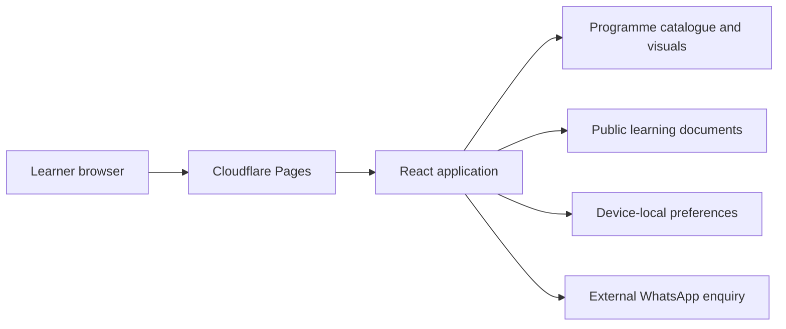

# Newton's 4th Training Academy

> Engineering documentation maintained by [LX Obsidian Labs](https://lxobsidian.co.za). Project: Newton’s 4th Training Academy. Institutional content remains subject to academy approval and applicable rights.

A responsive training discovery and introductory learning platform for a South African vocational training institution, developed by [LX Obsidian Labs](https://lxobsidian.co.za).

[Live website](https://newtons4th-academy.pages.dev/) · [Architecture](docs/ARCHITECTURE.md) · [Quality assurance](docs/QUALITY.md) · [Security](SECURITY.md)

## Product capabilities

- Searchable catalogue of 42 advertised training topics across six disciplines.
- Accessible original equipment illustrations and familiar-name search.
- Individual programme pages, comparison and saved shortlist.
- Printable prospectus, course handbooks and student preparation resources.
- Introductory practice quizzes with feedback and device-local progress.
- Programme-specific WhatsApp admissions enquiries.

## Technology

React 18, TypeScript, Vite 6, CSS, SVG and Cloudflare Pages. The current release is a static client application; it does not implement authenticated student accounts, a server-side admissions database or official academic records.

## Local development

Use Node.js 22 and npm.

```sh
npm install
npm run dev
npm run check
npm run build
npm run preview
```

Production output is generated in `dist/`. Cloudflare Pages should use `npm run build` and publish `dist`. See [deployment instructions](docs/DEPLOYMENT.md).

## Repository structure

| Path | Purpose |
| --- | --- |
| src/main.tsx | Application routes, catalogue and learning workflows |
| src/courseVisuals.tsx | Original course identification graphics and search aliases |
| src/style.css | Responsive presentation |
| public/documents/ | Printable learning and admissions resources |
| public/_headers | Hosting security headers |
| scripts/ | Repository integrity checks |
| docs/ | Engineering and operational documentation |

## Engineering boundaries

Illustrations are identification aids, not operating instructions. Study resources and quizzes are supplementary and require institutional review. Fees, availability, accreditation scope and certification must be verified by admissions. No employment guarantee is implied. WhatsApp enquiries leave the site; no application is stored by this application. Local progress is not an official record.

## Maintenance

Read [contribution guidance](CONTRIBUTING.md) before modifying programme data or learning materials. See [security reporting](SECURITY.md). No open-source licence is granted by this README; obtain permission from the relevant rights holders before redistribution.

## Complete documentation

See the [engineering documentation index](docs/README.md), [portfolio case study](docs/CASE-STUDY.md), [roadmap](docs/ROADMAP.md), [learner guide](docs/USER-GUIDE.md), [threat model](docs/THREAT-MODEL.md) and [changelog](CHANGELOG.md).

## System overview



The diagram represents the current static architecture, not a deployed LMS backend.
